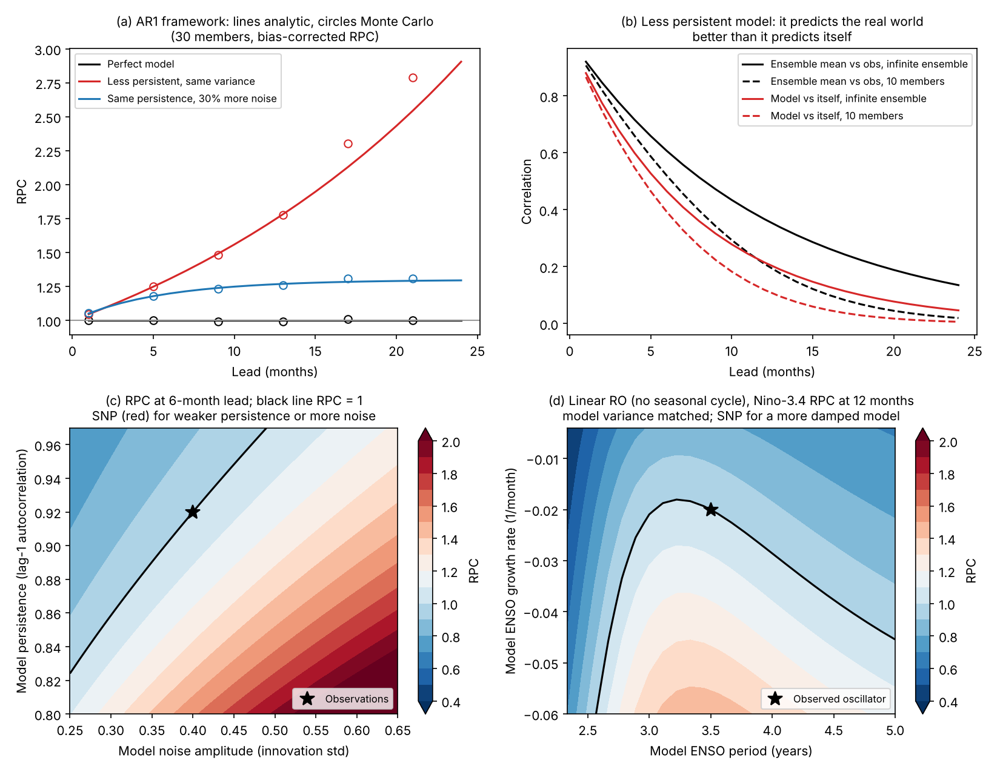
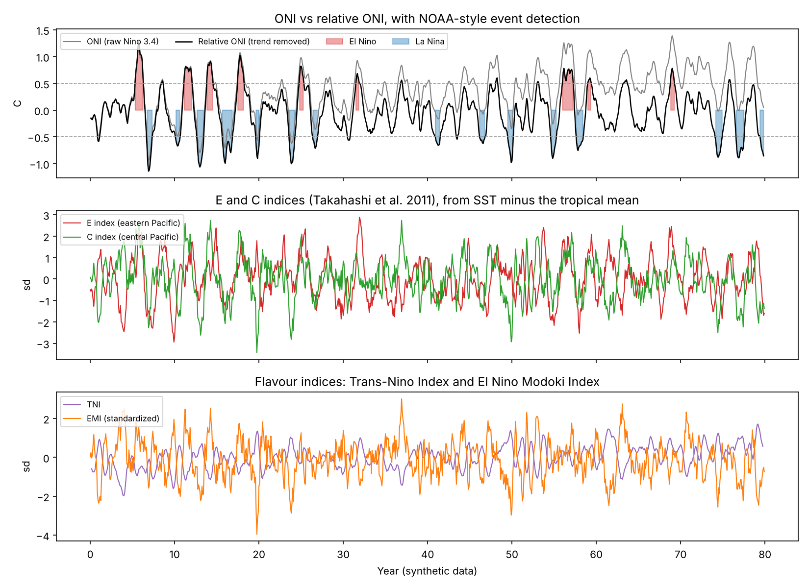
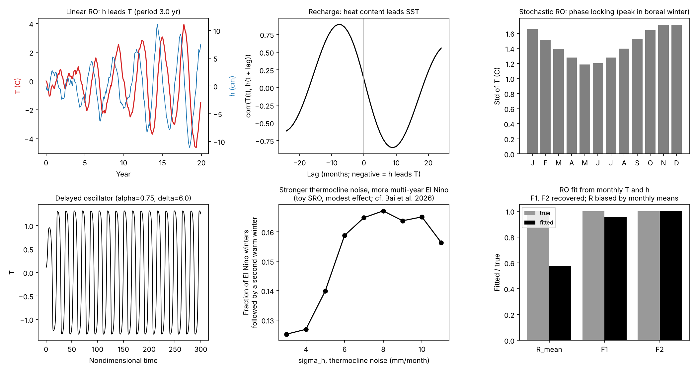
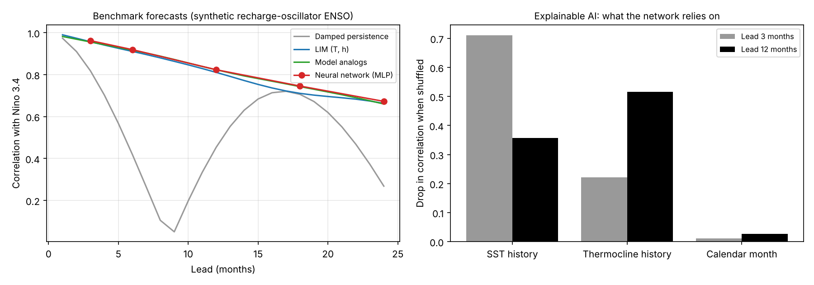
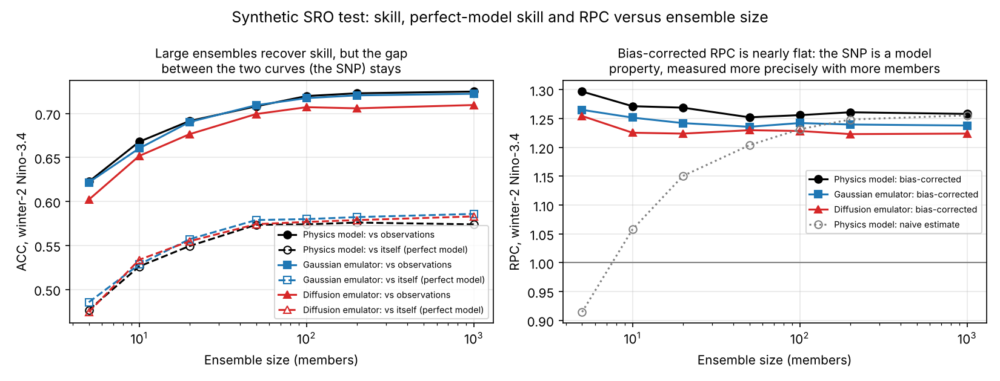

# AI4ENSO

Tools for studying El Niño–Southern Oscillation (ENSO) with observations, conceptual
models and AI. The focus is multi-year ENSO, predictability and the signal-to-noise paradox.

- **ENSO indices:** Niño regions, ONI, relative Niño 3.4, TNI, El Niño Modoki, E and C
  indices, SOI, 20 °C isotherm depth and warm water volume, plus detection of events and
  multi-year events.
- **Signal-to-noise paradox:** RPC and the ratio of squared correlations (RSC), corrected
  for finite-ensemble bias; the Markov (AR1) framework in closed form; exact predictability
  of a linear recharge oscillator; ensemble calibration.
- **ENSO dynamics:** linear and stochastic recharge oscillators, the delayed oscillator,
  and fitting recharge-oscillator parameters to data.
- **Forecast benchmarks:** damped persistence, linear inverse model (LIM), model analogs.
- **Explainable AI:** permutation importance, occlusion, integrated gradients, for any model.
- **Generative emulators:** expand a small hindcast ensemble to thousands of members, with
  a recharge-oscillator check of physical fidelity.

Everything runs on a laptop CPU with numpy, scipy, scikit-learn and matplotlib. The
examples use synthetic data from the conceptual models, so every result can be checked
against a known truth. The same functions take real data as numpy arrays.

## Install

```bash
git clone https://github.com/climatecafe/AI4ENSO.git
cd AI4ENSO
pip install -e .            # or: pip install -r requirements.txt
pip install -e ".[data]"    # optional: xarray and netCDF for real data files
python -m pytest            # 23 tests, a few seconds
```

## Package map

| Module | Contents | Docs |
|---|---|---|
| `ai4enso.indices` | ENSO indices, anomalies, event and multi-year event detection | [docs/indices.md](docs/indices.md) |
| `ai4enso.snp` | RPC, RSC, perfect-model skill, finite-ensemble corrections, calibration | [docs/snp.md](docs/snp.md) |
| `ai4enso.snp.markov` | Markov (AR1) signal-to-noise framework, analytic and Monte Carlo | [docs/snp.md](docs/snp.md#markov-ar1-framework-ai4ensosnpmarkov) |
| `ai4enso.snp.ro_predictability` | Exact skill and RPC of a linear recharge oscillator; growth rate and period | [docs/snp.md](docs/snp.md#the-snp-in-a-recharge-oscillator-ai4ensosnpro_predictability) |
| `ai4enso.dynamics` | Linear and stochastic recharge oscillators, delayed oscillator, parameter fitting | [docs/enso_dynamics.md](docs/enso_dynamics.md) |
| `ai4enso.forecast` | LIM, model analogs, persistence baselines | [docs/forecast_xai.md](docs/forecast_xai.md) |
| `ai4enso.xai` | Model-agnostic attribution methods | [docs/forecast_xai.md](docs/forecast_xai.md#explainable-ai-ai4ensoxai) |
| `ai4enso.emulator` | Gaussian and diffusion emulators of initialized hindcasts | [docs/emulator.md](docs/emulator.md) |
| `ai4enso.verification` | ACC, RMSE, MSSS, CRPS, spread–skill, lead-time helpers | |
| `ai4enso.io` | Template for reading model hindcast files (untested on real files) | |

## Examples

| Script | What it shows | Figure |
|---|---|---|
| `examples/01_enso_indices.py` | All indices on a synthetic SST field; ONI vs relative ONI under warming; events and multi-year events | `examples/figures/01_enso_indices.png`, `01_eofs.png` |
| `examples/02_snp_markov.py` | SNP in the Markov framework (analytic vs Monte Carlo, RPC map) and in a recharge oscillator | `examples/figures/02_snp_markov.png` |
| `examples/03_enso_dynamics.py` | Recharge and delayed oscillators, phase locking, multi-year El Niño vs thermocline noise, parameter fitting | `examples/figures/03_enso_dynamics.png` |
| `examples/04_forecast_benchmarks.py` | Damped persistence, LIM, model analogs and a neural network; explainable AI on the network | `examples/figures/04_forecast_benchmarks.png` |
| `examples/05_emulator_snp.py` | Generative emulators expand 20 members to 1000; SNP diagnosis, fidelity check, calibration | `examples/figures_emulator/` |

```bash
python examples/02_snp_markov.py
```

## Gallery

All figures come from the example scripts and use synthetic data.

**Signal-to-noise paradox in the Markov framework and a recharge oscillator** (`examples/02_snp_markov.py`)



**ENSO indices, event detection and E/C indices** (`examples/01_enso_indices.py`)



**Conceptual ENSO dynamics** (`examples/03_enso_dynamics.py`)



**Forecast benchmarks and explainable AI** (`examples/04_forecast_benchmarks.py`)



**Generative emulator: skill, perfect-model skill and RPC versus ensemble size** (`examples/05_emulator_snp.py`)



## Quick use

```python
import numpy as np
from ai4enso import indices as I, snp
from ai4enso.snp import markov

# ENSO index and multi-year events from an SST anomaly field (time, lat, lon)
oni = I.oni(I.relative_nino34(sst_anom, lat, lon))
djf, _ = I.winter_means(oni, months)
print(I.multiyear_summary(I.multiyear_events(djf / djf.std())))

# SNP diagnostics for a hindcast ensemble: ens (starts, members), obs (starts,)
print(snp.summary(ens, obs))          # ACC, perfect-model ACC, RPC, RSC, SNR

# Markov framework: a model less persistent than observations
out = markov.ar1_skill(a_obs=0.92, sigma_obs=0.4, a_model=0.88, sigma_model=0.5,
                       lead=np.arange(1, 25))
print(out["rpc"][[5, 11, 23]])
```

## Selected results from the examples

These results come from synthetic data:

- **Markov framework:** if the model has the observed variance but less persistence, RPC
  equals (a_obs / a_model)^lead. With a_obs = 0.92 and a_model = 0.88, RPC is 1.49 at
  9 months (Monte Carlo: 1.48).
- **Finite ensembles:** the naive RPC rises from 0.91 with 5 members to 1.26 with 1000. The
  bias-corrected RPC stays between 1.25 and 1.30 at every size, so more members measure
  the SNP better but do not remove it.
- **Recharge oscillator:** with constant coefficients and matched variance, a model more
  damped than observations has an SNP (RPC about 1.3 at 12 months). Period differences
  alone do not produce one without a seasonal cycle.
- **Explainable AI:** a neural network predicting Niño 3.4 relies mostly on SST at a
  3-month lead and on thermocline depth at a 12-month lead, as recharge theory predicts.

## Contributing and citing

Issues and pull requests are welcome. If you use this code, please cite the repository and
the original papers for each method (listed in the docs pages).

## References

Key references for the package as a whole. Each docs page lists the references for its
methods.

- Bai, K., Jin, Y., Zhang, W., Lin, X., & Kirtman, B. (2026). Atmospheric noise forcing increases multiyear El Niño events. *GRL*, 53(14), e2026GL123553.
- Eade, R., et al. (2014). Do seasonal-to-decadal climate predictions underestimate the predictability of the real world? *GRL*, 41, 5620–5628.
- Jin, F.-F. (1997). An equatorial ocean recharge paradigm for ENSO. Part I: Conceptual model. *J. Atmos. Sci.*, 54, 811–829.
- Jin, Y. (2022). The signal-to-noise paradox in ENSO prediction: Role of ENSO growth rate and period. *GRL*, 49(12), e2022GL097965.
- Lin, Z., Jin, Y., He, C., Zhang, S., McPhaden, M. J., & Lin, X. (2026). Deep learning reveals enhanced ENSO predictability under historical anthropogenic forcing. *Science Advances*, 12(24), eaec9518.
- Penland, C., & Sardeshmukh, P. D. (1995). The optimal growth of tropical sea surface temperature anomalies. *J. Climate*, 8, 1999–2024.
- Scaife, A. A., & Smith, D. (2018). A signal-to-noise paradox in climate science. *npj Clim. Atmos. Sci.*, 1, 28.
- Zhang, W., & Kirtman, B. (2019). Understanding the signal-to-noise paradox with a simple Markov model. *GRL*, 46(22), 13308–13317.
- Zhang, W., Kirtman, B., Siqueira, L., Clement, A., & Xia, J. (2021). Understanding the signal-to-noise paradox in decadal climate predictability from CMIP5 and an eddying global coupled model. *Climate Dynamics*, 56(9), 2895–2913.
