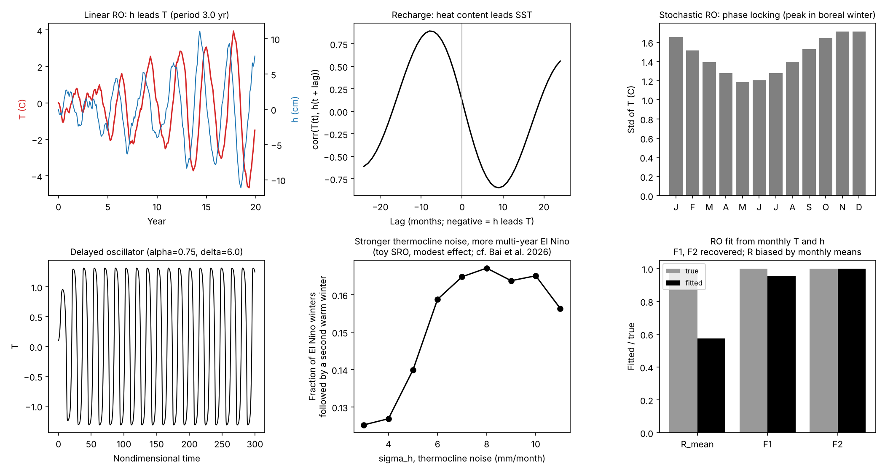

# Conceptual ENSO dynamics (`ai4enso.dynamics`)

## Recharge oscillator

The recharge oscillator (Jin 1997) describes ENSO as a coupled cycle between eastern
Pacific SST (T) and equatorial heat content, measured by thermocline depth or warm water
volume (h). During El Niño, westerly wind anomalies drive poleward Sverdrup transport that
discharges equatorial heat content. The shallower thermocline then cools the east and ends
the event. During La Niña, the equator recharges.

**Linear form** (`LinearRO`, after Burgers et al. 2005):

    dT/dt = R T + F1 h + noise
    dh/dt = −F2 T − ε h + noise

| Parameter | Meaning |
|---|---|
| R | SST growth/damping rate: Bjerknes feedbacks minus damping |
| F1 | thermocline feedback efficiency |
| F2 | recharge efficiency (Sverdrup transport) |
| ε | damping of h |

The matrix A = [[R, F1], [−F2, −ε]] has eigenvalues growth ± iω. So the ENSO growth rate
is (R − ε)/2, and the period is 2π/ω with ω² = F1 F2 − Rε − ((R − ε)/2)². With R = −0.03
per month, F1 = 7.48, F2 = 0.0042 and ε = 0, the period is about 3 years. Heat content
leads SST by roughly a quarter period, about 8 months (`examples/figures/03_enso_dynamics.png`).

**Stochastic, seasonally varying form** (`SROParams`, `simulate`, `make_hindcasts`), as in
Bai et al. (2026) after Vialard et al. (2025):

    dT/dt = R(m) T + F1 h + σ_T w_T(t) [1 + B H(T) T]
    dh/dt = −F2 T + σ_h w_h(t)

- R(m) varies with calendar month, which gives phase locking to boreal winter.
- The multiplicative noise (B > 0, H the Heaviside function) is stronger during warm
  events, which produces asymmetry.
- σ_h is the noise acting on thermocline depth. In the CCSM4 interactive-ensemble
  experiments of Bai et al. (2026), it controls how often El Niño persists into a second
  year. Stronger σ_h weakens the heat-content discharge after the first peak.

In this package R(m) is an assumed cosine, not a fit to observations.

**Fitting** (`fit_ro`): monthly tendencies of T and h are regressed on their anomalies,
following Vijayeta & Dommenget (2018) and Bai et al. (2026). R is fitted for each calendar
month, F1 and F2 are constant, and the residual standard deviations give σ_T and σ_h. F1
and F2 are recovered well from simulated data. R is biased by the use of monthly means, so
compare datasets (observations, a model, an emulator) with the same estimator rather than
treating the values as absolute. Comparing these parameters across datasets is the "ROM
fingerprint" used to check emulators.

## Delayed oscillator

The delayed-action oscillator (Suarez & Schopf 1988) represents the negative feedback from
equatorial waves that reflect at the western boundary and return after a delay δ:

    dT/dt = T − T³ − α T(t − δ)

With α < 1 and a long enough delay, it produces self-sustained oscillations
(`DelayedOscillator`, nondimensional units; default α = 0.75, δ = 6).

## Multi-year ENSO

Multi-year events (an El Niño or La Niña lasting two or more winters) are linked to
several processes. These include weak heat-content discharge after the first peak,
stochastic forcing of the thermocline (Bai et al. 2026), extratropical and inter-basin
influences such as the North Pacific Oscillation, and the preferential occurrence of
multi-year La Niña after strong El Niño. `ai4enso.indices.multiyear_events` finds these
events in any index. `examples/03_enso_dynamics.py` shows, in the toy oscillator, a modest
increase in multi-year El Niño persistence with σ_h, in the same direction as Bai et al.
(2026).

## Figure

## References

- Bai, K., Jin, Y., Zhang, W., Lin, X., & Kirtman, B. (2026). Atmospheric noise forcing increases multiyear El Niño events. *GRL*, 53(14), e2026GL123553.
- Burgers, G., Jin, F.-F., & van Oldenborgh, G. J. (2005). The simplest ENSO recharge oscillator. *GRL*, 32, L13706.
- Jin, F.-F. (1997). An equatorial ocean recharge paradigm for ENSO. Part I: Conceptual model. *J. Atmos. Sci.*, 54, 811–829.
- Suarez, M. J., & Schopf, P. S. (1988). A delayed action oscillator for ENSO. *J. Atmos. Sci.*, 45, 3283–3287.
- Vialard, J., et al. (2025). The ENSO recharge oscillator conceptual model: Achievements and future prospects. *Reviews of Geophysics*, 63(1), e2024RG000843.
- Vijayeta, A., & Dommenget, D. (2018). An evaluation of ENSO dynamics in CMIP simulations in the framework of the recharge oscillator model. *Climate Dynamics*, 51, 1753–1771.
