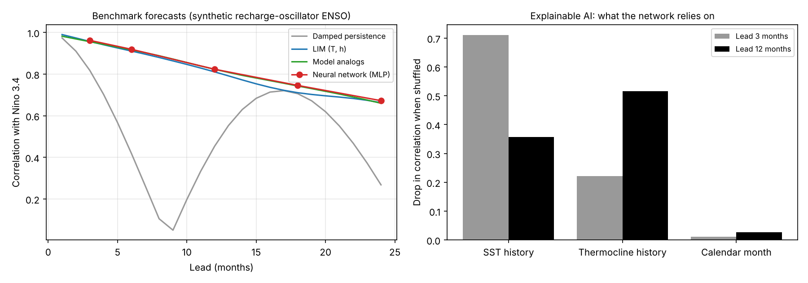

# Forecast benchmarks and explainable AI

Any new ENSO predictor, AI or otherwise, should be compared with simple and established
methods. `ai4enso.forecast` provides four.

## Benchmarks (`ai4enso.forecast`)

**Persistence and damped persistence** (`persistence`, `damped_persistence`,
`lag_autocorrelation`). Damped persistence scales the current anomaly by the lag
autocorrelation r(τ). For an oscillating index r(τ) turns negative at about half a period,
so the scaled forecast can regain skill at long leads. Use `start_month` to compute
seasonally dependent persistence (the spring barrier).

**Linear inverse model** (`LIM`; Penland & Sardeshmukh 1995). The model assumes
dx/dt = L x + white noise. From lag covariances:

    G(τ0) = C(τ0) C(0)⁻¹,   L = log G(τ0) / τ0,   Q = −(L C(0) + C(0) Lᵀ)

The forecast is expm(L τ) x(t). Q should be positive semi-definite (`noise_check`). The
eigenmodes of L give decay rates and periods, and `optimal_growth` gives the initial
pattern that grows most over a lead, a precursor analysis.

**Model analogs** (`ModelAnalog`, `build_library`; after Ding et al. 2018 and Lenssen et
al. 2024). This method finds the K states in a long model run that are closest to the
current state, usually at the same calendar month, and uses their subsequent evolution as
an ensemble. It is nonlinear, cheap, and a strong multi-year ENSO baseline.

On recharge-oscillator data (`examples/04_forecast_benchmarks.py`), LIM, analogs and a
neural network all reach a correlation of about 0.81–0.82 at 12 months. The toy system is
nearly linear, so a neural network has little to add there. Real data are needed to test
whether AI adds skill.

## Explainable AI (`ai4enso.xai`)

These tools are model-agnostic: they take any prediction function f(X), such as
`model.predict` from scikit-learn or a wrapper around a PyTorch network.

| Method | What it measures | Function |
|---|---|---|
| Permutation importance | Drop in correlation when a feature group is shuffled | `permutation_importance` |
| Occlusion | Change in prediction when a feature group is set to a baseline (climatology) | `occlusion` |
| Integrated gradients | Path-integrated gradient attribution (Sundararajan et al. 2017); gradients by central finite differences; attributions sum to f(x) − f(baseline) | `integrated_gradients` |

Grouping features (for example all lags of SST, all lags of heat content, or a geographic
region) gives attributions that can be interpreted physically. In the benchmark example,
shuffling SST history costs 0.71 in correlation at a 3-month lead and 0.36 at 12 months.
Shuffling thermocline history costs 0.22 and 0.52. So the network relies on heat content at
long leads, as recharge theory predicts.

Attribution methods can disagree in geoscience applications (Mamalakis et al. 2022).
Compare several methods and several trained networks, and check the results against
physical expectations, for example with the recharge-oscillator fit in
`ai4enso.dynamics.rofit`.

## Figure

## References

- Ding, H., Newman, M., Alexander, M. A., & Wittenberg, A. T. (2018). Skillful climate forecasts of the tropical Indo-Pacific Ocean using model-analogs. *J. Climate*, 31, 5437–5459.
- Ham, Y.-G., Kim, J.-H., & Luo, J.-J. (2019). Deep learning for multi-year ENSO forecasts. *Nature*, 573, 568–572.
- Lenssen, N., et al. (2024). Strong El Niño events lead to robust multi-year ENSO predictability. *GRL*.
- Lin, Z., Jin, Y., He, C., Zhang, S., McPhaden, M. J., & Lin, X. (2026). Deep learning reveals enhanced ENSO predictability under historical anthropogenic forcing. *Science Advances*, 12(24), eaec9518.
- Mamalakis, A., Barnes, E. A., & Ebert-Uphoff, I. (2022). Investigating the fidelity of explainable artificial intelligence methods for applications of convolutional neural networks in geoscience. *Artificial Intelligence for the Earth Systems*, 1, e220012.
- Penland, C., & Sardeshmukh, P. D. (1995). The optimal growth of tropical sea surface temperature anomalies. *J. Climate*, 8, 1999–2024.
- Sundararajan, M., Taly, A., & Yan, Q. (2017). Axiomatic attribution for deep networks. *Proc. ICML*.
