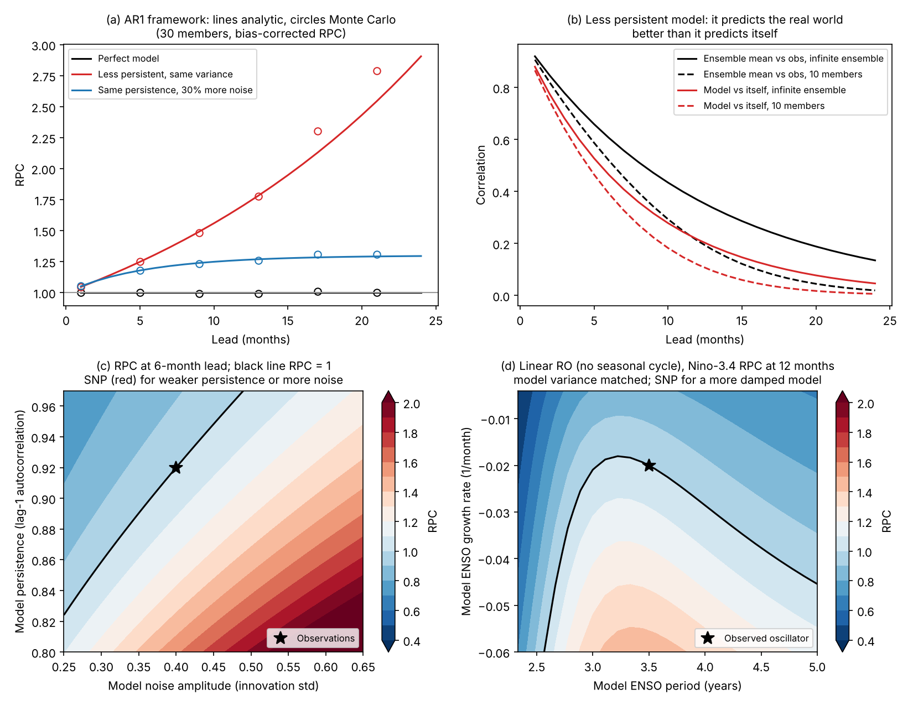

# The signal-to-noise paradox (SNP)

## What it is

In many initialized predictions, the ensemble mean of a model correlates better with the
real world than with the model's own ensemble members (Eade et al. 2014; Scaife & Smith
2018). Put another way, the model is better at predicting reality than at predicting
itself. That is paradoxical: the model's predictable signal is too weak relative to its
noise, so it underestimates how predictable the real world is.

Consequences:

- **Large ensembles are needed.** Each member carries only a weak signal, so many members
  must be averaged before the signal emerges. Small ensembles underestimate the skill that
  is actually achievable.
- **Probabilities are underconfident.** Even with a large ensemble, the forecast
  distribution is too wide and its signal amplitude too small. That needs calibration.
- **More members do not remove it.** A larger ensemble measures the SNP more precisely.
  The paradox itself comes from the model (for example, too little persistence or too
  much noise) and stays.

## Measures (`ai4enso.snp`)

Notation: `ens` has shape (starts, members), `obs` has shape (starts,). The ensemble mean
over N members is m, and the noise variance is the mean within-ensemble variance.

| Quantity | Definition | Function |
|---|---|---|
| ACC | r(m, obs) | `ai4enso.verification.acc` |
| Perfect-model ACC | r(mean of the other N−1 members, one member), averaged over members | `perfect_model_acc` |
| Signal variance | var(m) − var_noise / N (unbiased) | `signal_variance` |
| Predictable fraction | var_signal / var_total, the model's own predictable variance fraction | `predictable_fraction` |
| Model SNR | sqrt(var_signal / var_noise) | `model_snr` |
| RPC | ACC / sqrt(predictable fraction) (Eade et al. 2014) | `rpc`, `rpc_corrected` |
| RSC | r²(m, obs) / r²(m, member): the ratio of squared correlations | `rsc`, `rsc_corrected` |

RPC > 1 (equivalently RSC > 1) indicates the SNP. For an infinite ensemble, RSC = RPC².

### Finite-ensemble bias

The ensemble mean of N members still contains noise of variance var_noise / N. That has
two effects, and both bias the naive RPC low. First, it inflates var(m), so using var(m)
as the signal variance overestimates the model's predictable fraction. Second, it lowers
the correlation of m with observations:

    r_N = r_inf * sqrt(var_signal / var(m))

`rpc_corrected` uses the unbiased signal variance and r_inf, so its expected value does not
depend on ensemble size. In `examples/05_emulator_snp.py`, the naive RPC rises from 0.91
with 5 members to 1.26 with 1000, while the corrected RPC stays between 1.25 and 1.30.

## Markov (AR1) framework (`ai4enso.snp.markov`)

Zhang & Kirtman (2019) represented ensemble forecasts with a simple Markov model and
argued that the SNP depends primarily on the persistence and noise variance of the model
relative to observations. The expressions below were derived for this package in that
setting. Check them against the paper's notation before quoting them.

Observations and model members are AR(1) processes with monthly persistence a and
innovation standard deviation σ:

    y(t+1) = a_o y(t) + e_o          (observations)
    x(t+1) = a_m x(t) + e_m          (each model member)

The stationary variance is s² = σ² / (1 − a²). Every forecast starts from the observed
state y0, which is known perfectly. At lead τ:

    obs:     y   = a_o^τ y0 + noise,  noise variance V_o = s_o² (1 − a_o^(2τ))
    member:  x_i = a_m^τ y0 + noise,  noise variance V_m = s_m² (1 − a_m^(2τ))

The model signal variance is S² = a_m^(2τ) s_o². It follows that:

    ACC(N)      = a_o^τ S / sqrt(S² + V_m / N)
    PM(N)       = S² / sqrt((S² + V_m / (N−1)) (S² + V_m))
    ACC(∞)      = a_o^τ
    PM(∞)       = S / sqrt(S² + V_m)
    RPC         = ACC(∞) / PM(∞),   RSC = RPC²

Two special cases make the mechanism clear:

- **Equal variance (s_m = s_o):** RPC = (a_o / a_m)^τ. The SNP appears exactly when the
  model is less persistent than the real world, and grows with lead.
- **Equal persistence (a_m = a_o):** a noisier model (s_m > s_o) has a smaller predictable
  fraction, so RPC > 1.

`ar1_skill` evaluates these formulas, `simulate_ar1_hindcasts` checks them by Monte Carlo
(they agree to within about 1% at 3–9 month leads with 20,000 starts), and `rpc_map` maps
RPC over model persistence and noise (`examples/figures/02_snp_markov.png`).

## The SNP in a recharge oscillator (`ai4enso.snp.ro_predictability`)

For the linear recharge oscillator d[T, h]/dt = A [T, h] + noise, the eigenvalues of A give
the ENSO growth rate and period. `ro_skill` computes the exact infinite-ensemble skill and
RPC of a model oscillator forecasting an observed one. It uses the matrix exponential
propagator, Van Loan's method for the accumulated noise covariance, and the Lyapunov
equation for the stationary covariance. `matrix_from_growth_period` builds an oscillator
with a chosen growth rate and period.

Jin (2022) showed with a recharge oscillator that the ENSO SNP can arise from a larger
growth rate and shorter period in the observations, even when observed persistence is
lower, not only from a persistence deficit. The linear version here has constant
coefficients and so no spring barrier or phase locking. With the model variance matched to
observations, it finds the following:

- A **more damped model** (lower growth rate) gives RPC > 1, about 1.3 at 12 months for a
  growth rate of −0.05 instead of −0.02 per month.
- A **period mismatch** alone mainly adds phase error and lowers RPC.

So the period effect described by Jin (2022) is not captured without a seasonal cycle. To
study it, use the seasonally varying stochastic RO (`ai4enso.dynamics.stochastic_ro`) with
Monte Carlo hindcasts.

## SNP in forced responses

The same symptom appears for externally forced signals. Forced decadal signals in models
are too weak relative to internal noise for several regional modes (Clement et al. 2026),
tropical Atlantic multidecadal variability is mostly forced (He et al. 2023), and
multi-decadal NAO projections require rescaling by the ratio of predictable signals (Smith
et al. 2025). Comparing training on historical and preindustrial-control simulations is
one way to separate forced and initialized contributions.

## Correcting for the SNP (`calibrate_ensemble`)

Following Eade et al. (2014), the ensemble is calibrated in two steps:

1. **Signal:** the ensemble mean is rescaled so its variance equals r² var(obs). The factor,
   r · std(obs) / std(m), equals the regression slope of the observations on m, which is
   the RPS scaling used by Smith et al. (2025). So for the ensemble mean the two corrections
   coincide.
2. **Noise:** member deviations are rescaled so their variance equals (1 − r²) var(obs).

The factors come from training years. Estimate them with an ensemble of the same size as
the one being calibrated, because var(m) depends on N. In the emulator example,
calibration brings the spread–skill ratio from 1.15 to 1.04 but does not improve CRPS on
the test years. The statistical factor is sensitive to sampling, which is a motivation for
physically based corrections.

## Figure

## References

- Clement, A. C., Cane, M. A., Klavans, J. M., He, C., & Murphy, L. N. (2026). A signal-to-noise problem in model simulation of decadal climate modes. *J. Climate*, 39(11), 2853–2869.
- Eade, R., et al. (2014). Do seasonal-to-decadal climate predictions underestimate the predictability of the real world? *GRL*, 41, 5620–5628.
- He, C., et al. (2023). Tropical Atlantic multidecadal variability is dominated by external forcing. *Nature*, 622, 521–527.
- Jin, Y. (2022). The signal-to-noise paradox in ENSO prediction: Role of ENSO growth rate and period. *GRL*, 49(12), e2022GL097965.
- Scaife, A. A., & Smith, D. (2018). A signal-to-noise paradox in climate science. *npj Clim. Atmos. Sci.*, 1, 28.
- Smith, D. M., et al. (2025). Mitigation needed to avoid unprecedented multi-decadal North Atlantic Oscillation magnitude. *Nature Climate Change*, 15, 403–410.
- Van Loan, C. F. (1978). Computing integrals involving the matrix exponential. *IEEE Trans. Automatic Control*, 23(3), 395–404.
- Zhang, W., & Kirtman, B. (2019). Understanding the signal-to-noise paradox with a simple Markov model. *GRL*, 46(22), 13308–13317.
- Zhang, W., Kirtman, B., Siqueira, L., Clement, A., & Xia, J. (2021). Understanding the signal-to-noise paradox in decadal climate predictability from CMIP5 and an eddying global coupled model. *Climate Dynamics*, 56(9), 2895–2913.
